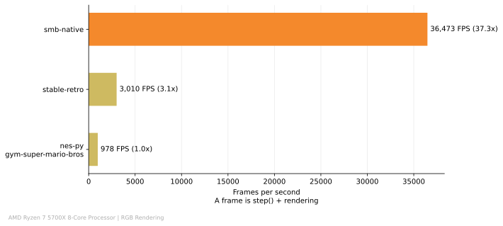

# Super Mario Bros. Gym Environment

A statically recompiled [Super Mario Bros.](https://en.wikipedia.org/wiki/Super_Mario_Bros.) environment for Reinforcement Learning and Dataset Generation, designed as a faster alternative to traditional emulators such as [gym-super-mario-bros](https://pypi.org/project/gym-super-mario-bros/)

## How fast?



***

As shown in the graph, specifically for my **Ryzen 7 5700X3D**, the recomp runs over 37.3x faster than nes-py (wrapped by [gym-super-mario-bros](https://github.com/Kautenja/gym-super-mario-bros)) and 12.1x faster than stable-retro.  
This benchmark specifically play backs a [famous TAS](https://tasvideos.org/1715M) called "warps", sequentially for each emulator to compare, to reduce as much as possible variance related to code branching and randomness.  

Have a look at additional [**Benchmark Results**](#benchmark-results) or see [**Limitations**](#limitations).

## Getting Started
> [!NOTE]
> There is no PyPI package or prebuilt wheel, the build needs **your own ROM** (see [Legal Note](#legal-note--license)), everything is compiled locally.  
> `-march=native` is used by default for building, so don't copy the compiled library/wheel to another machine, rebuild it there.

This repo builds a **Python package** `smb_native` (includes the Gymnasium wrapper), which is what you want in most cases, and optionally a **C++ shared library** which is arguably more performant and can be used for RL via LibTorch and such.

### Requirements
- Python 3.10+ (virtual env is recommended)
- CMake 3.18+
- A C++20 compiler (GCC or Clang) <!-- TODO: min versions? -->
- OpenMP (optional, automatically used if found for [vectorization api](#native-vectorization))
- Your own Super Mario Bros. ROM

The SHA-1 of the ROM without iNES header must be exactly `facee9c577a5262dbe33ac4930bb0b58c8c037f7`, if you are unsure, just proceed with the build, it will fail if the ROM is invalid.

This guide was built for Linux users (tested on Linux Mint), on Windows you can use WSL, on MacOS you can use Clang and follow the same steps, but both are untested, feel free to [open an issue](#contributing) if you encounter any problems.

### Setup

1\. Clone the repository, create a Python environment and activate it:  
```bash
git clone https://github.com/Veddy1674/smb-recomp-gym
cd smb-recomp-gym
python3 -m venv .venv && source .venv/bin/activate
```
<sup>If you're unable to create the virtual environment: `sudo apt install python3-venv`</sup>

2\. Manually put your ROM in the `assets` directory and make sure it's named exactly `smb.nes`!  
<!-- TODO: allow rom with any name -->

#### Now pick whether you want to [use the libraries](#install) or [edit the source](#for-developers).

***
### Install

Return to terminal, build and install the python library:  
```bash
pip install .
```

That's it, the ROM is only read once at build time (by [`dump_rom.py`](assets/dump_rom.py)) to generate `game_data.hpp`.  
The first build takes a while due to -O3 & -flto flags.

If you get errors regarding "Invalid ROM", try a different ROM and make sure it's named exactly `smb.nes` and is inside the `assets` folder, next to `dump_rom.py` itself!
<!-- TODO: allow rom with any name -->

Quick test to see if the library is working:
```bash
python -c "import smb_native"
```
Make sure you are running this in the virtual environment, not the system Python or any other.

### C++ Library <small>(optional)</small>

If you want to use the C++ shared library instead, it can be built without or together the Python bindings:
```bash
cmake -B build -DBUILD_CPP_LIBRARY=ON
cmake --build build -j
sudo cmake --install build
```
**For Linux users only**, update the shared library cache:  
```bash
sudo ldconfig
```
This installs the shared library and headers to `/usr/local` by default, use `-DCMAKE_INSTALL_PREFIX=...` to change it.  
(Python 3.10+ is still required here to run [`dump_rom.py`](assets/dump_rom.py)!).

To use the shared library in a project, from CMake:
```cmake
find_package(smb_native REQUIRED)
target_link_libraries(app PRIVATE smb_native::smb_native)
```
Or link manually with `-lsmb_native` flag.

#### See [**Build Options**](#build-options) or [**Usage**](#usage) to begin.

***
### For Developers

Editable install, **without** build isolation so the build directory (`build/skbuild`) stays stable and rebuilds are incremental:
```bash
pip install --group dev
pip install -e . --no-build-isolation
```
**NOTE:** `--group` requires pip 25.1+, run `pip install -U pip` first to upgrade, or just `pip install scikit-build-core nanobind`.

Editing Python files in `python/smb_native/` takes effect immediately.  
On the other side, **after touching any C++ file you have to rebuild**:
```bash
pip install -e . --no-build-isolation -v
```

### Build Options
| Option | Default | What it does |
|---|---|---|
| `BUILD_PYTHON_BINDINGS` | `OFF` (`ON` via pip) | builds the Python bindings (nanobind) |
| `BUILD_CPP_LIBRARY` | `ON` (`OFF` via pip) | builds and installs the shared C++ library |
| `REMOVE_RESIDUAL` | `ON` | removes unused/unreachable code (~1-2% faster) |

You can apply the build options from CMake:  
`-DREMOVE_RESIDUAL=OFF`  
Or from pip:  
`-C cmake.define.REMOVE_RESIDUAL=OFF`.  

## Usage
There are three ways to use it, from highest to lowest level:

1\. [**Gymnasium Wrapper**](#gymnasium-wrapper) (Python), for RL, very similar to [gym-super-mario-bros](https://github.com/Kautenja/gym-super-mario-bros) in syntax and usage  
2\. [**Python low-level API**](#python-low-level-api), the raw environment used for the Gymnasium wrapper, 1:1 with the C++ one  
3\. [**C++ shared library**](#c-shared-library), highly performant, tiny memory footprint, gym-like syntax  

Due to [how fast](#benchmark-results) the step() function alone is, Python introduces a significant overhead compared to C++, whereas with step() + frame rendering the difference is much smaller.

### Gymnasium Wrapper
<sup>(Requires Gymnasium >= 1.2.0 and numpy, if you followed the building instructions correctly, you're all set)</sup>

```python
import gymnasium as gym
from gymnasium.error import ClosedEnvironmentError
import smb_native.gym_env as smb # registers 'SMB-v0'
gym.register_envs(smb) # no-op

env = gym.make(
    "SMB-v0",
    obs_type="rgb", # 'rgb', 'grayscale', 'indexed', 'ram'
    render_mode="human", # None, 'rgb_array', 'human'
    preset="W1L1", # 'ColdBoot', 'TitleScreen', 'W1L1' ... 'W8L4'
    frame_skip=4,
    action_set="simple", # 'right_only', 'simple', 'complex', list[int]
    max_episode_steps=800, # truncation is handled by gym's TimeLimit, infinite by default
)
obs, info = env.reset()

terminated = truncated = False
try:
    while not (terminated or truncated):
        obs, reward, terminated, truncated, info = env.step(env.action_space.sample())

except ClosedEnvironmentError as e: # window closed manually
    print(e)
  
finally:
    env.close()
```
<sup>This snippet requires `pygame` installed for the `human` render_mode to function.</sup>

> [!NOTE]
> `frame_skip` and `grayscale` rendering are **native**, so don't use the relative wrappers, they would only add overhead.

**`env.close()`** is not necessary unless you're using `human` render_mode, but is good practice.

**Observation** shapes (numpy arrays):
- `RGB`: **(240, 256, 3)** uint8
- `Grayscale`: **(240, 256)**, uint8
- `Indexed`: **(240, 256)** uint8 <small>(See [`renderer.cpp`](src/core/renderer.cpp) yourself for info)</small>
- `RAM`: **(2048,)** uint8 <small>(No rendering, so it's the fastest option)</small>

**Render Mode**:
- `None`: render() returns None
- `rgb_array`: render() always returns a RGB frame, regardless of obs_type
- `human`: renders the frame in a window at 60 FPS (smooth with frame_skip > 1 too), render() returns None

**Preset Mode**:  
What state to load when .reset() is called; all presets are created once when the `smb_native` library is imported, to avoid tiny overheads for each reset call.
- `ColdBoot` starts at the very beginning of the game, first few frames will be gray/black until the title screen appears.  
- `TitleScreen` starts at the title screen, start can be pressed right away to start the game.  
`W1L1` to `W8L4` starts at the beginning of the specified level (4 levels per world, 8 worlds)

**Frame Skip**:  
Native, runs NMI multiple times per step() directly in a C++ loop

**Action Set**:
`right_only`, `simple` and `complex` are pre-made action sets you can use.  
Alternatively, use your own action set as a `list[int]`, library `smb_native` exposes 'Input' IntFlag to easily create custom action sets, for example:
```python
from smb_native import Input

my_actions = [
    Input.DOWN, # down
    Input.RIGHT | Input.B, # right + B
    Input.RIGHT | Input.A, # right + A
    Input.RIGHT | Input.B | Input.A, # right + B + A
]
```

**Custom reward:**  
Pass `reward_function=func` as argument, with `func(prev_state: SMBEnv, curr_state: SMBEnv) -> float`.  
<sub>`curr_state` is the live env, not a copy! So treat it as read-only to avoid issues.</sub>  
<sup>`SMBEnv` is the raw environment created by the low-level Python API, [so have a look at its usage for more details](#python-low-level-api).</sup>

**`info` contains:**
- `x`: Absolute X position of Mario
- `y`: Absolute/Screen Y position of Mario
- `time`: Remaining time in the level
- `lives`: Number of lives Mario has
- `coins`: Number of coins Mario has
- `score`: Current score, not highscore
- `mario_state`: Mario's current raw state (see [here](https://datacrystal.tcrf.net/wiki/Super_Mario_Bros./RAM_map) at address **0x000E**)
- `win`: True when the flagpole/axe is touched

To unwrap the environment and access the native low-level API, use `unwrap(env)` from `smb_native.gym_env`:
```python
from smb_native import SMBEnv
from smb_native.gym_env import unwrap

base: SMBGymEnv = unwrap(env) # has typing from gym_env.py
native: SMBEnv = base.native # uses python low-level API

# unwrapping is useful to read and write to RAM, which can be accessed
# from SMBGymEnv and SMBEnv, because SMBGymEnv has a @property method for it:
base.ram[0x075e] = 99
native.ram[0x075e] = 99

print(native.get_coins())
```
Or use `.unwrapped` but gym.make returns wrapped envs typed as `gym.Env`, so IDEs can't autocomplete `native` / `ram`.

> [!WARNING]
> **Vectorization is WIP.**  
> [`SMBEnvVec` was just implemented](#native-vectorization), but not the relative Gymnasium wrapper for it.  
> For now you can use Gymnasium's own `gym.make_vec`.

<!-- ### Gymnasium Vectorization

*** -->

### Python low-level API
The [Gymnasium Wrapper](#gymnasium-wrapper) is built on top of this.

```python
import numpy as np
from smb_native import SMBEnv, Input

env = SMBEnv()
env.reset(preset="W1L1") # load level 1-1

env.step(Input.RIGHT | Input.B, 10) # hold RIGHT + B for 10 frames

action = Input.B | Input.RIGHT | Input.LEFT

# invalid actions such as RIGHT + LEFT and UP + DOWN can be validated with:
action = env.validate_input(action) # result is Input.B alone

env.step(action)

frame = env.get_frame(render_mode="rgb") # allocs a new (240, 256, 3) numpy array

# or render into a preallocated buffer
buf = np.empty((240, 256, 3), dtype=np.uint8)
env.get_frame(buf, render_mode="grayscale")

print("Horizontal Speed: ", env.ram[0x0057]) # 2KB RAM, zero-copy view (not a copy!)
print("Coins: ", env.get_coins()) # utility that reads the correct address automatically

# savestates are quick copies of RAM + PPUState
save = env.copy()
env.step(Input.LEFT, 60)
env = save.copy()

if env == save: # RAM comparison
    print("'env' equals 'save' byte per byte!")

print("Hash: ", hash(env)) # hashing is shallow, confirm with == on collision!

envs = [env.copy() for _ in range(10)]
for i in range(len(envs) - 1): # step all but last
    envs[i].step(Input.A, 10)
  
if env.equals_any(envs):
    print("Found a match!")
```

**Summary:**  
To step the game logic, use **`step(action: int, times: int = 1)`**, you can use `Input` IntFlag for actions, which is casted to an int automatically.

To render a frame, use **`get_frame(render_mode: str = "rgb")`** or **`get_frame(buf: np.ndarray, render_mode: str = "rgb")`**, available options are: `rgb`, `grayscale`, `indexed`; rendering is optional after a step.

You can also render only specific sprites using **`render_sprite(first_slot: int, count: int)`** - It returns a numpy array as RGBA uint8 with the specified metasprite slots rendered (and transparent background), and two integers which represent the exact X and Y position in pixels where the sprite is supposed to be; it does not render the whole screen so it's much faster than `get_frame`, and it doesn't have a variant with buffer argument (as it doesn't have much use cases anyway), `render_sprite_mario()` automatically renders Mario's metasprites (8), frame shape is always (32, 16, 4) - **Note that returned image (first element of the tuple) can be None if the sprite is not found/visible, x and y will have a value of 0 in that case**.

**`env.ram`** is a view (not a copy) of the game's RAM (0x800 or 2048 bytes), can be read and written into.  
All the RAM-reading utilities:  
\- **get_mario_state()** (See [here](https://datacrystal.tcrf.net/wiki/Super_Mario_Bros./RAM_map) at address **0x000E**)  
\- **is_death_state()** (True if **get_mario_state()** equals 0x0B or 0x06, or **get_viewport_y()** > 1)  
\- **is_win_state()** (True when the flagpole/axe is touched)  
\- **get_terminated()** (True if **is_death_state()** or **is_win_state()**)  
\- **get_lives()**  
\- **get_coins()**  
\- **get_time()**  
\- **get_score()**  
\- **get_high_score()**  
\- **get_viewport_y()** (1 = inside, 0 = above, >1 = below, e.g. falling into a pit)  
\- **get_abs_y()** (Equivalent to Screen Y, sorta)  
\- **get_abs_x()** (Absolute X Position of Mario in the level: **(ram[0x6D] << 8) | ram[0x86]**)  
\- **get_screen_x()** (Mario's X position on the screen from the left edge)  

The environment's state is the RAM itself, it can be copied with **`copy()`** (which also copies the PPUState), and it can be compared with **`equals(env: SMBEnv)`** or **`equals_any(envs: Iterable[SMBEnv])`** (Which only compare the RAM).
<!-- TODO add copy_at(env) ??? -->

The environment's state can be hashed shallowly with `hash(env)`, so a `set` of environments can be made (for example in a search algorithm to avoid duplicates), but upon collision the two states should be compared with `.equals()` or `==` which natively compares via `std::memcmp`, to avoid false positives.  
Hashing only applies to RAM, not PPUState.

#### Native Vectorization

`SMBEnvVec` features native C++ vectorization using OpenMP, if the project [was built without it](#requirements), it will function single-threadedly.  
The syntax is very close to the `SMBEnv` class, similar methods end with suffix "_all".

```python
from smb_native import SMBEnvVec, Input
import numpy as np

envs = SMBEnvVec(n_envs=64) # create 64 instances at once
envs.reset_all(preset="W1L1") # uses multi-threading

action_space = [
    Input.RIGHT,
    Input.LEFT
]

# array of n_envs actions randomly chosen from action_space
actions = np.random.choice(action_space, size=envs.n_envs)

# pre-allocated buffer (optional)
frames = np.empty((envs.n_envs, 240, 256, 3), dtype=np.uint8)

# step all 64 environments at once, each with its own action, frameskip 4
envs.step_all(actions, times=4) # uses multi-threading

# get 64 240x256 RGB uint8 frames at once
envs.get_frame_all(frames, render_mode="rgb") # uses multi-threading

envs.at(0).reset(preset="ColdBoot") # reset one single environment

# direct indexing and slicing works as well
for env in envs[1:3]:
    env.reset(preset="ColdBoot")

# access RAM and get/set values, multiple instances at once
envs.ram_all[:, 0xce] = 20 # (this changes mario absolute Y position)

# get env idx with highest abs_x
all_x = envs.get_abs_x_all()
idx = np.argmax(all_x)

print(f"Env {idx + 1}/{envs.n_envs} has abs X = {all_x[idx]}")

ram_copy = envs.get_ram_all() # copy of envs.ram_all, contiguous (n_envs, 2048) uint8

# iterate through every environment (type Iterable[SMBEnv])
for i, env in enumerate(envs, start=1):
    if i % 8 == 0:
        print(f"Env {i} has abs Y = {env.get_abs_y()}")
```

**Notes:**  
\- **`.reset_all(...)`**, **`.step_all(...)`**, **`.get_frame_all(...)`** use multi-threading, utilities that access RAM, such as **`.get_abs_x_all()`** are serial on purpose, as array accessing is usually faster this way.  
\- Every environment can be individually accessed via `direct indexing`, `slicing`, or with **`at(index: int)`**; `SMBEnvVecIterator` iterates through all the environments.  
\- **`.n_envs`** read-only property is the amount of environments the class is managing, initialized in the constructor; Equivalent to `len()`.  
\- **`.num_threads()`** returns the amount of threads used for multi-threading, by default it's the amount of virtual processors your main CPU has, if you built without OpenMP, it returns 1.

***

### C++ shared library
All the documentation here is equivalent to [Python low-level API](#python-low-level-api) (except methods use PascalCase instead of snake_case), including vectorization, so have a look there.  
Using the C++ library is usually preferred for better raw performance over the Python API or the [Gymnasium Wrapper](#gymnasium-wrapper).
```cpp
#include <smb/core/env.hpp>

int main() {
    SMBEnv::InitResetPresets(); // optional, avoids a slow first reset()

    SMBEnv env;
    env.Reset(ResetPreset::W1L1); // load level 1-1
    env.Step(Input::RIGHT | Input::B, 10); // hold RIGHT + B for 10 frames 

    uint8_t frame[FrameBytesOf(RenderMode::RGB)];
    env.RenderFrame(frame, RenderMode::RGB);
}
```

## Benchmark Results

Every time I mention "the TAS" in this README, I am strictly referring to that ["warps" TAS](https://tasvideos.org/1715M) cited at the beginning.

First of all, you can run the same benchmark shown [here](#how-fast) yourself (make sure you followed all the steps [here](#getting-started) first!):  
```bash
pip install -r benchmark/requirements.txt
python benchmark/run_envs.py
python benchmark/make_graphs.py
```
[`run_envs.py`](benchmark/run_envs.py) runs the TAS on different emulators and this recomp, sequentially, multiple times and with warmups, then outputs the results to `benchmark/results.jsonl`.  
[`make_graphs.py`](benchmark/make_graphs.py) then processes the results and generates a graph in `benchmark/graphs/`.  

My own results were left over as `benchmark/readme_results.jsonl` to prove the graph's source.  
`warpless.fm2` and `warpless_lag.txt` were left over for you to quickly run the TAS yourself and see what the .txt should look like where lag frames are noted.

### Proving Accuracy and Determinism

To prove the accuracy of the recompiled code against cycle-accurate emulators, I ran the TAS and compared the RAM between stable-retro and the recomp, which resulted in:
```java
RAM match at frame 100: 91.70% (w/o stack: 99.16%)
RAM match at frame 8933: 91.41% (w/o stack: 98.77%)
RAM match at frame 16867: 90.97% (w/o stack: 98.33%)
RAM match at frame 17865: 91.26% (w/o stack: 98.72%)
Overall RAM match: 91.31% (w/o stack: 98.65%)
Lowest RAM match: 84.77% (w/o stack: 91.85%) at frame 15055
Highest RAM match: 92.33% (w/o stack: 100.00%) at frame 33
Frames with 100% match (w/o stack): 8 / 17843 (0.04%)
```

#### Why does RAM matching with and without the stack differ so much?
The stack occupies 256 of the NES's 2048 bytes of Working RAM, which is around 12.5% (from 0x100 to 0x1FF).  
It holds temporary data such as JSR return addresses.  
As stated in the [limitations](#limitations) section, the CPU's program counter is not emulated in this recomp, which results in the stack area accounting up to ~7-8% of the RAM mismatch because the emulated JSR does not write to stack; whereas without the stack **the RAM matches 98.65%** on average (and 100% during some frames - it could be during the title screen, before the soundtrack begins).

#### Does this mean the recomp has serious glitches?
No, it just means it's not cycle-accurate like an emulator, for any use case that doesn't regard dumping RAM and expecting 100% accuracy against real hardware, this recompilation works just as well as any other emulator.  
There are no visual glitches, physics bugs, wrong collisions or anything noticeable or that could affect an AI agent or casual playthrough.
<!-- contributing if bugs are found or UB -->

<!-- #### Why is the RAM matching % the lowest at frame 2?
During ColdBoot routine, many lag frames occur consecutively, during
The reason most of the memory mismatch occurs in the very first frames is because during ColdBoot routine, many lag frames happen consecutively, to replicate this behavior of lag frames in the recomp, `step()` is skipped when a lag frame occurs, which results in the emulator being ahead until the next non-lag frame, where `step()` in the recomp does what the emulator took 2-3 calls.  
The other ~2% of mismatch occurs mainly because of `SoundEngine` being also omitted. -->

You can run this test yourself (make sure you followed all the steps [here](#getting-started) first!):  
```bash
pip install -r benchmark/requirements.txt
python benchmark/ram_compare.py
```
[`ram_compare.py`](benchmark/ram_compare.py) runs the TAS for stable-retro and the recomp, stores every RAM array each frame and compares them (excluding during lag frames), then prints info regarding RAM matching in percentage.

## Limitations

Here's a list of all the limitations this recompilation has compared to traditional emulators, and the reasons why the RAM mismatches occur and what "not cycle-accurate" means:

- For performance and readability reasons, the CPU's program counter is not emulated, which means the [`JumpEngine`](https://gist.github.com/1wErt3r/4048722#file-smbdis-asm-L2370) routine was omitted in favor of C++ switches, and computed gotos were used to mimic JSR and RTS instructions, which results in equivalent behavior but **slight RAM mismatches** around the stack ($0100 to $01FF) because JSR doesn't write "current program counter minus one" to the stack as it is supposed to, thus after many steps the stack may represent up to 7.67% of the RAM mismatch when compared, in addition, glitches that take advantage of **arbitrary code execution** are *not* reproducible and will likely cause unexpected behavior.

- **No cycle-accuracy, no lag frames**, each step always executes a full NMI (NonMaskableInterrupt, the `step()`) from start to end, unlike emulators which replicate the CPU's limit of ~29,780 cycles per NMI, this recomp doesn't, which means a TAS made for an emulator will quickly desynchronize; for more info, look at the [Benchmark Results](#benchmark-results) section where it's explained how this was handled.  
(For RL, this actually doesn't matter as lag frames occur mostly during loading screens, and if they occur when too many enemies are on screen or such, it is possibly beneficial as it is less noisy for a net)

- For the sake of optimization, the entire [`SoundEngine`](https://gist.github.com/1wErt3r/4048722#file-smbdis-asm-L15045) routine (and related subroutines) were omitted from the recompilation entirely, which doesn't lead to unexpected behavior, but inevitably causes more **slight RAM mismatches** (percentage still unknown, estimated ~3%).

For most use cases, this recompilation works just as fine as any other emulator, it can be used for reinforcement learning, optimizing TASes (for example through input brute-forcing) or even to play through the game normally.  
(Little side note, if it's used for a TAS meant to play on real hardware, lag frames have to be added artificially)

## Contributing
Contributions are very appreciated, whether it's a bug report, feature request, or even correcting a typo.

- **Bugs:** open an issue with steps to reproduce the bug (inputs/seed if possible).  
Differences NOT mentioned in the [Limitations](#limitations) section are very appreciated, along with game glitches, desyncs, UB, etc.

- **Pull requests:** keep them focused and explain what changed and why. If you touch `game.cpp`, (e.g. to optimize a label, even if it drifts from the disassembly it's okay) you need to demonstrate with tests it didn't break anything [regarding accuracy and determinism](#proving-accuracy-and-determinism) and/or benchmark the before and after (you can use [my benchmarks](#benchmark-results)).

- **AI-assisted code** is fine, as long as you are able to explain every change and its consequence.

- **Never** attach ROMs or copyrighted assets to issues/PRs, and please don't ask for a prebuilt wheel with an embedded ROM, it won't happen (see [Legal Note](#legal-note--license) below).

## Legal Note & License

- No ROM, graphics, audio or other game assets are distributed in this repository.  
- The [recompiled source](src/core/game.cpp) is a translation of the game’s logic from 6502 Assembly to C++, derived from a [community disassembly](https://gist.github.com/1wErt3r/4048722) made by reverse-engineering the original ROM. The game logic itself remains **Nintendo's intellectual property**, this repo only contains my translation of it.  
- **Your own legally obtained ROM** is always required for compilation.  
- This project is not affiliated with or endorsed by Nintendo, and exists for research and educational purposes.

The [MIT](LICENSE) license applies only to: the tooling, bindings, wrappers, benchmarks and my own work on the recompilation.  
It grants nothing over Nintendo's property, nor the `warpless.fm2` file (see the [TASVideos license](https://tasvideos.org/SiteLicense)).

## Acknowledgements

- Special thanks to doppelganger and the other creators of the [disassembly](https://gist.github.com/1wErt3r/4048722) of the game, which was used as a reference for the recompilation, specifically [here](src/core/game.cpp).
- Thanks to [NESDev](https://www.nesdev.org) Community for their very helpful [documentation](https://www.nesdev.org/wiki/Instruction_reference) regarding the CPU 6502 instruction set.
- Thanks to [TASVideos](https://tasvideos.org) Community for their excellent TAS videos which helped with benchmarking and proving accuracy and determinism.
- Thanks to **Christian Kauten** and the developers behind [gym-super-mario-bros](https://github.com/Kautenja/gym-super-mario-bros) and [nes-py](https://github.com/Kautenja/nes-py) for establishing the standard reinforcement learning API baseline for this game.
- Thanks to **Farama Foundation** and its developers behind [stable-retro](https://github.com/Farama-Foundation/stable-retro) which helped with comparing benchmarks & [proving accuracy](#proving-accuracy-and-determinism).
- And of course, thanks to **Nintendo** for creating the game and revolutionizing the gaming industry, which happened to give RL a very useful environment still in use today for testing and benchmarking models.

## Citation

If you use this repository in your research, please cite it as:

```bibtex
@misc{smb_recomp_gym,
  author = {Veddy1674},
  title = {Super Mario Bros. Static Recompilation and Gym Wrappers},
  year = {2026},
  howpublished = {\url{https://github.com/Veddy1674/smb-recomp-gym}},
  note = {GitHub repository}
}
```