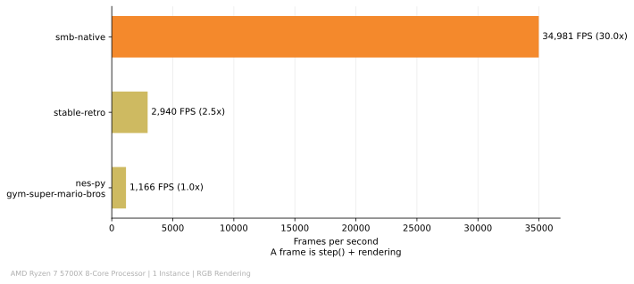

# Super Mario Bros. Gym Environment

A statically recompiled [Super Mario Bros.](https://en.wikipedia.org/wiki/Super_Mario_Bros.) environment for Reinforcement Learning and Dataset Generation, designed as a faster alternative to traditional emulators such as [gym-super-mario-bros](https://pypi.org/project/gym-super-mario-bros/)

## How fast?



***

For common use, over 30x faster than the most common emulator used for RL, [nes-py](https://github.com/Kautenja/nes-py), often wrapped with [gym-super-mario-bros](https://github.com/Kautenja/gym-super-mario-bros).  
This benchmark specifically playbacks a [famous TAS](https://tasvideos.org/1715M) called "warps", sequentially for each emulator to compare, to reduce as much as possible variance related to code branching and randomness.  

Have a look at additional [**Benchmark Results**](#benchmark-results) or [**Get Started**](#getting-started).

## Benchmark Results

Every time I mention "the TAS" in this README, I am strictly referring to that ["warps" TAS](https://tasvideos.org/1715M) cited at the beginning.

... TODO ...

You can run the same benchmark shown [here](#how-fast) yourself (make sure you followed all the steps [here](#getting-started) first!):  
```bash
pip install -r benchmark/requirements.txt
python benchmark/run_envs.py
python benchmark/make_graphs.py
```
[`run_envs.py`](benchmark/run_envs.py) runs the TAS on different emulators and this recomp, sequentially, multiple times and with warmups, then outputs the results to `benchmark/results.jsonl`.  
[`make_graphs.py`](benchmark/make_graphs.py) then processes the results and generates a graph in `benchmark/graphs/`.  

My own results were left over as `benchmark/readme_results.jsonl` to prove the graph's source.  
`warpless.fm2` and `warpless_lag.txt` were left over for you to quickly run the TAS yourself and see what the .txt should look like where lag frames are noted.

### Proving Accuracy and Determinism

To prove the accuracy of the recompiled code against cycle-accurate emulators, I ran the TAS and compared the RAM between stable-retro and the recomp, which resulted in:
```java
RAM match at frame 100: 91.70% (w/o stack: 99.16%)
RAM match at frame 8933: 91.41% (w/o stack: 98.77%)
RAM match at frame 16867: 90.97% (w/o stack: 98.33%)
RAM match at frame 17865: 91.26% (w/o stack: 98.72%)
Overall RAM match: 91.31% (w/o stack: 98.65%)
Lowest RAM match: 84.77% (w/o stack: 91.85%) at frame 15055
Highest RAM match: 92.33% (w/o stack: 100.00%) at frame 33
Frames with 100% match (w/o stack): 8 / 17843 (0.04%)
```

#### Why does RAM matching with and without the stack differ so much?
The stack occupies 256 of the NES's 2048 bytes of Working RAM, which is around 12.5% (from 0x100 to 0x1FF).  
It holds temporary data such as JSR return addresses.  
As stated in the [limitations](#limitations) section, the CPU's program counter is not emulated in this recomp, which results in the stack area accounting up to ~7-8% of the RAM mismatch because the emulated JSR does not write to stack; whereas without the stack **the RAM matches 98.65%** on average (and 100% during some frames - it could be during the title screen, before the soundtrack begins).

#### Does this mean the recomp has serious glitches?
No, it just means it's not cycle-accurate like an emulator, for any use case that doesn't regard dumping RAM and expecting 100% accuracy against real hardware, this recompilation works just as well as any other emulator.  
There are no visual glitches, physics bugs, wrong collisions or anything noticeable or that could affect an AI agent or casual playthrough.
<!-- contributing if bugs are found or UB -->

<!-- #### Why is the RAM matching % the lowest at frame 2?
During ColdBoot routine, many lag frames occur consecutively, during
The reason most of the memory mismatch occurs in the very first frames is because during ColdBoot routine, many lag frames happen consecutively, to replicate this behavior of lag frames in the recomp, `step()` is skipped when a lag frame occurs, which results in the emulator being ahead until the next non-lag frame, where `step()` in the recomp does what the emulator took 2-3 calls.  
The other ~2% of mismatch occurs mainly because of `SoundEngine` being also omitted. -->

You can run this test yourself (make sure you followed all the steps [here](#getting-started) first!):  
```bash
pip install -r benchmark/requirements.txt
python benchmark/ram_compare.py
```
[`ram_compare.py`](benchmark/ram_compare.py) runs the TAS for stable-retro and the recomp, stores every RAM array each frame and compares them (excluding during lag frames), then prints info regarding RAM matching in percentage.

## Getting Started
TODO

## Limitations

Here's a list of all the limitations this recompilation has compared to traditional emulators, and the reasons why the RAM mismatches occur and what "not cycle-accurate" means:

- For performance and readability reasons, the CPU's program counter is not emulated, which means the [`JumpEngine`](https://gist.github.com/1wErt3r/4048722#file-smbdis-asm-L2370) routine was omitted in favor of C++ switches, and computed gotos were used to mimic JSR and RTS instructions, which results in equivalent behavior but **slight RAM mismatches** around the stack ($0100 to $01FF) because JSR doesn't write "current program counter minus one" to the stack as it is supposed to, thus after many steps the stack may represent up to 7.67% of the RAM mismatch when compared, in addition, glitches that take advantage of **arbitrary code execution** are *not* reproducible and will likely cause unexpected behavior.

- **No cycle-accuracy, no lag frames**, each step always executes a full NMI (NonMaskableInterrupt, the `step()`) from start to end, unlike emulators which replicate the CPU's limit of ~29,780 cycles per NMI, this recomp doesn't, which means a TAS made for an emulator will quickly desynchronize; for more info, look at the [Benchmark Results](#benchmark-results) section where it's explained how this was handled.  
(For RL, this actually doesn't matter as lag frames occur mostly during loading screens, and if they occur when too many enemies are on screen or such, it is possibly beneficial as it is less noisy for a net)

- For the sake of optimization, the entire [`SoundEngine`](https://gist.github.com/1wErt3r/4048722#file-smbdis-asm-L15045) routine (and related subroutines) were omitted from the recompilation entirely, which doesn't lead to unexpected behavior, but inevitably causes more **slight RAM mismatches** (percentage still unknown, estimated ~3%).

For most use cases, this recompilation works just as fine as any other emulator, it can be used for reinforcement learning, optimizing TASes (for example through input brute-forcing) or even to play through the game normally.  
(Little side note, if it's used for a TAS meant to play on real hardware, lag frames have to be added artificially)

## Legal Note & License

- No ROM, graphics, audio or other game assets are distributed in this repository, not via source code nor via wheel distribution.
- The [recompiled source](src/core/environment.cpp) is a translation of the game’s logic from Assembly 6502 to C++, derived from a [community disassembly](https://gist.github.com/1wErt3r/4048722) of the original ROM.
- **Your own legally obtained ROM** is always required for compilation.
- This project is not affiliated with or endorsed by Nintendo.

The license for this project is [MIT](LICENSE) and is exclusively applied to the source code of this repository. It does not cover any Nintendo property or the `warpless.fm2` distributed file, (information about the license can be found in the [TASVideos website](https://tasvideos.org/SiteLicense)).

## Acknowledgements

- Special thanks to doppelganger and the other creators of the [disassembly](https://gist.github.com/1wErt3r/4048722) of the game, which was used as a reference for the recompilation, specifically [here](src/core/environment.cpp).
- Thanks to [NESDev](https://www.nesdev.org) Community for their very helpful [documentation](https://www.nesdev.org/wiki/Instruction_reference) regarding the CPU 6502 instruction set.
- Thanks to [TASVideos](https://tasvideos.org) Community for their excellent TAS videos which helped with benchmarking and proving accuracy and determinism.
- Thanks to **Christian Kauten** and the developers behind [gym-super-mario-bros](https://github.com/Kautenja/gym-super-mario-bros) and [nes-py](https://github.com/Kautenja/nes-py) for establishing the standard reinforcement learning API baseline for this game.
- And of course, thanks to **Nintendo** for creating the game and revolutionizing the gaming industry, which happened to give RL a very useful environment still in use today for testing and benchmarking models.

## Citation

If you use this repository in your research, please cite it as:

```bibtex
@misc{smb_recomp_gym,
  author = {Veddy1674},
  title = {Super Mario Bros. Static Recompilation and Gym Wrappers},
  year = {2026},
  howpublished = {\url{https://github.com/Veddy1674/smb-recomp-gym}},
  note = {GitHub repository}
}
```